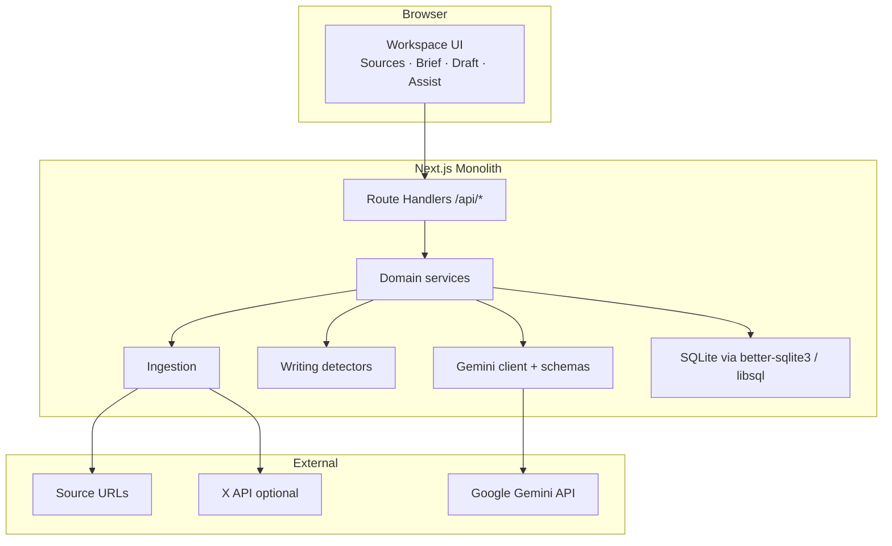
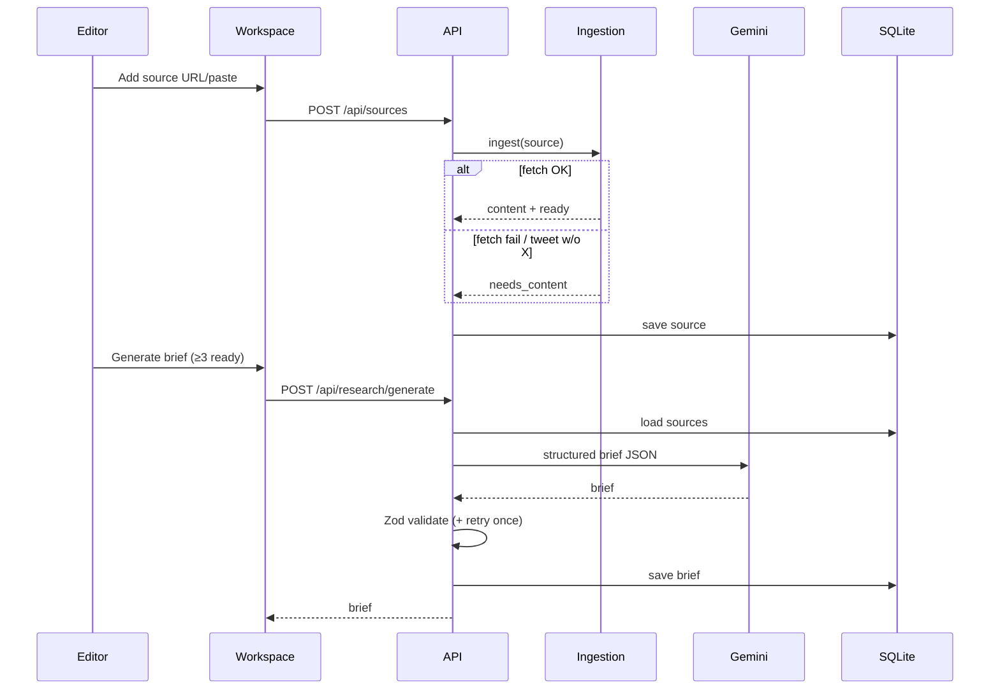
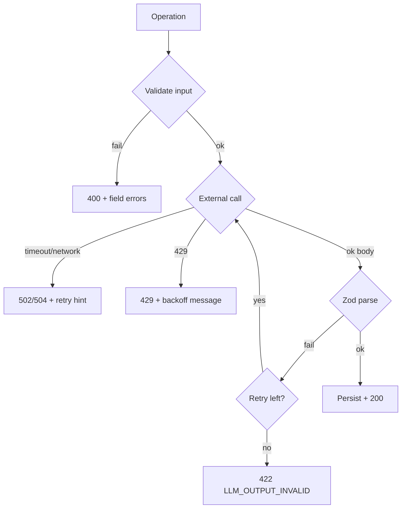
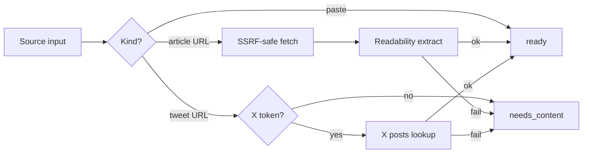
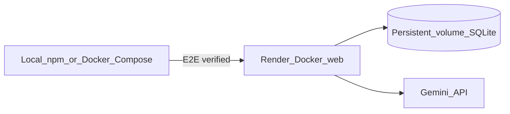

# System Architecture

**Status:** Phase 3 — ready for review  
**Stack authority:** ADR-010  
**Last updated:** 2026-11-02

## 1. Overview

A Next.js (App Router, TypeScript) monolith that implements a single-user **AI Editorial Workspace**:

Sources → Research brief → Sectioned draft → Writing assist  

Persistence is a local **SQLite** file. All LLM calls go to **Gemini** (Flash-class) via the official SDK, with Zod validation of structured outputs. The UI follows `design-system/this-week-in-ai-editorial/`.



## 2. Directory shape (planned)

```text
app/
  layout.tsx, page.tsx          # workspace shell
  api/
    projects/...
    sources/...
    research/...
    draft/...
    writing/...
lib/
  db/                           # schema, migrations, repos
  ingestion/                    # fetch, readability, x, ssrf
  llm/                          # gemini client, prompts, zod schemas
  research/                     # brief generation
  draft/                        # starter/outline/section regen
  writing/                      # detectors, metrics, suggestion merge
  validation/
components/                     # UI aligned to design system
design-system/                  # ui-ux-pro-max (already present)
docs/
```

## 3. Component responsibilities

| Component | Responsibility |
|---|---|
| Workspace UI | Stage stepper, forms, highlights, accept/reject, metrics |
| Projects API | Load/create default project; persist stage artifacts |
| Sources service | Add/update sources; trigger ingest; duplicate URL check |
| Ingestion | SSRF-safe fetch; Readability extract; optional X lookup; status machine |
| Research service | Build prompt from sources; Gemini structured brief; edit + full regen |
| Draft service | Starter draft / outline / section regen; keep `original` snapshot |
| Writing detectors | Deterministic complex / passive / filler; metrics |
| Writing suggest | Non-overlap resolve; Gemini explain+rewrite; apply accept/reject |
| Gemini client | Timeouts, retries on malformed JSON, rate-limit surfacing |
| SQLite repos | CRUD for project graph |

## 4. Data flows

### 4.1 Research workflow



### 4.2 Draft workflow

```mermaid
sequenceDiagram
  participant U as Editor
  participant API as API
  participant LLM as Gemini
  participant DB as SQLite

  U->>API: POST /api/draft/generate (mode, angleId)
  API->>DB: load brief + sources
  API->>LLM: starter_draft | outline_only
  LLM-->>API: sections JSON
  API->>API: validate
  API->>DB: save draft; snapshot original_text
  U->>API: POST /api/draft/sections/:id/regenerate
  API->>LLM: section regen w/ siblings + brief
  API->>DB: update section; keep original unless reset policy
```

**Original snapshot policy:** On first successful starter-draft generation (or first Analyze if outline/manual), persist `draft.original_snapshot`. Section regen updates **working** content only; original snapshot unchanged until user explicitly “Reset original baseline” (optional MVP: no reset — original stays first snapshot). Accept suggestion updates working text only.

### 4.3 Writing workflow

```mermaid
sequenceDiagram
  participant U as Editor
  participant API as API
  participant Det as Detectors
  participant LLM as Gemini
  participant DB as SQLite

  U->>API: POST /api/writing/analyze
  API->>Det: detect issues
  Det-->>API: candidate spans
  API->>API: non-overlap priority filter
  API->>LLM: batch explain+rewrite for spans
  LLM-->>API: suggestions
  API->>DB: replace suggestion set (pending)
  U->>API: POST /api/writing/suggestions/:id/accept
  API->>DB: apply rewrite to working draft; mark accepted
```

### 4.4 Error-handling flow



## 5. API boundaries (summary)

Full contracts in §API of `TECHNICAL_REQUIREMENTS.md` (updated). Prefix: `/api`. JSON only. No auth headers in MVP.

## 6. LLM integration

- **Provider:** Google Gemini only (ADR-010)  
- **Tasks:** brief generation, draft/outline/section generation, writing explain+rewrite  
- **Not LLM:** URL fetch, detectors, metrics, overlap resolution, SSRF checks  
- **Prompts:** versioned strings in `lib/llm/prompts/*` with semver comment headers  
- **Output:** JSON schema prompts + Zod parse; 1 automatic repair retry  
- **Grounding rule:** prompts require source IDs on factual claims; UI renders links from stored sources — never invent URLs  

No LangChain / multi-agent runtime.

## 7. Source ingestion architecture



Limits (initial): fetch timeout 10s; max response 1.5MB; block localhost/link-local/private/metadata IPs; user-agent identifiable.

## 8. Security architecture

| Concern | Approach |
|---|---|
| API keys | Server-only env (`GEMINI_API_KEY`, optional `X_BEARER_TOKEN`) |
| SSRF | URL allowlist scheme http(s); DNS/IP checks; no redirects to private |
| Input size | Cap paste length and section sizes |
| Secrets in git | `.env*` gitignored; `.env.example` committed |
| Auth | None (local single-user) — document that deploy demos are unprotected |

## 9. Deployment architecture



- **Unit of deploy:** Docker image of the Next.js process (UI + `app/api/**`) — ADR-015. No separate backend service.
- **DB path in containers:** `DATABASE_PATH=/data/editorial.db` on a persistent volume / Compose bind mount.
- **Blueprint:** `render.yaml` (Render) + `docker-compose.yml` (local).
- Vercel + file SQLite explicitly avoided (ADR-006/010).

## 10. Testing architecture

- **Unit:** detectors, metrics, overlap resolver, SSRF URL guards, Zod schemas  
- **Integration:** API routes with test DB file; mock Gemini  
- **Manual E2E:** J1–J3 checklist in IMPLEMENTATION_PLAN  

## 11. Provider abstraction

**None** beyond a thin `lib/llm/client.ts` wrapper around Gemini. Groq deferred; adding it later is a new ADR.
