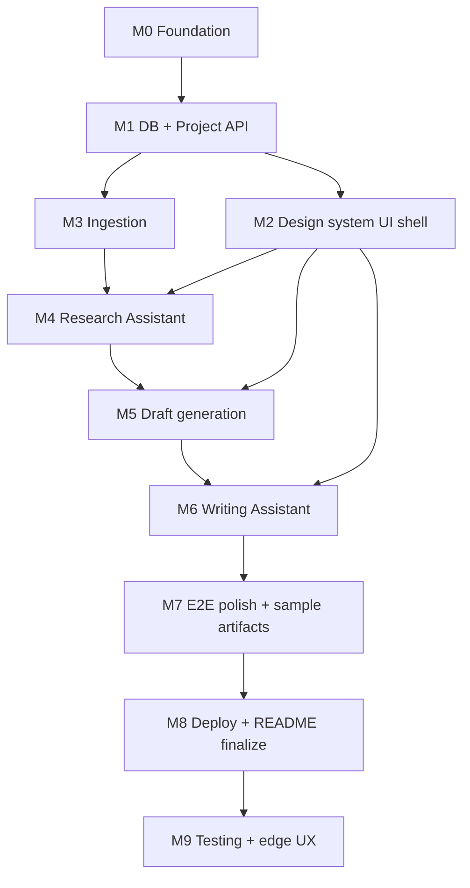

# Implementation Plan

**Status:** Phase 3 — ready for review  
**Gate:** No coding until `APPROVE PLAN AND AUTHORIZE IMPLEMENTATION`  
**Last updated:** 2026-11-03

## Dependency graph

---

## M0 — Project foundation

| | |
|---|---|
| **ID** | M0 |
| **Objective** | Scaffold Next.js + tooling without product features |
| **Scope** | App bootstrap, ESLint/TS, Tailwind tokens from design system, env example, gitignore for secrets/db |
| **Tasks** | Create Next.js TS app; add Tailwind; map CSS variables from MASTER.md; add `.env.example`; wire `GEMINI_API_KEY`, `GEMINI_MODEL`, `DATABASE_PATH`, optional `X_BEARER_TOKEN` |
| **Files** | `package.json`, `app/`, `tailwind.config.*`, `.env.example`, `.gitignore` |
| **Dependencies** | ADR-010 |
| **Deliverables** | App boots empty shell locally |
| **Tests** | `npm run build` succeeds |
| **Acceptance** | Dev server runs; design tokens present; no secrets committed |
| **DoD** | Build green; README stub with setup placeholders |
| **Risks** | Disk space on machine |

---

## M1 — Database + project persistence

| | |
|---|---|
| **ID** | M1 |
| **Objective** | SQLite schema + default project load/save |
| **Scope** | Migrations for SCHEMA.md entities; repository helpers; `GET/POST /api/projects` |
| **Tasks** | Choose Drizzle or raw better-sqlite3; implement schema; ensure single default project bootstrap |
| **Files** | `lib/db/**`, `app/api/projects/**` |
| **Dependencies** | M0 |
| **Deliverables** | Persisted project row survives restart |
| **Tests** | DB unit/integration: create project, reload |
| **Acceptance** | FR-070 |
| **DoD** | Schema matches SCHEMA.md; migration documented |
| **Risks** | Over-abstracted ORM — keep thin |

---

## M2 — Workspace UI shell (design system)

| | |
|---|---|
| **ID** | M2 |
| **Objective** | Stage stepper UI matching ui-ux-pro-max workspace page |
| **Scope** | Layout, stages, empty states, typography (Libre Bodoni + Public Sans via next/font), Lucide icons |
| **Tasks** | Implement shell; Sources/Brief/Draft/Writing placeholders; loading/empty patterns |
| **Files** | `app/**`, `components/**`, fonts |
| **Dependencies** | M0 (can parallel M1 after tokens) |
| **Deliverables** | Navigable stages, no dashboard clutter |
| **Tests** | Smoke render; manual responsive check |
| **Acceptance** | DESIGN.md + workspace.md |
| **DoD** | Checklist items for contrast/focus started |
| **Risks** | Reverting to Inter/dark — forbidden |

---

## M3 — Source ingestion

| | |
|---|---|
| **ID** | M3 |
| **Objective** | Add sources with URL/paste/X-optional + SSRF-safe fetch |
| **Scope** | Source CRUD API; readability extraction; status machine; UI forms |
| **Tasks** | Implement ingestion pipeline; duplicate URL guard; needs_content paste recovery |
| **Files** | `lib/ingestion/**`, `app/api/sources/**`, Sources UI |
| **Dependencies** | M1, M2 |
| **Deliverables** | ≥3 sources can become `ready` |
| **Tests** | SSRF unit tests; mock fetch success/fail; duplicate URL |
| **Acceptance** | FR-001–007, NFR-002, NFR-005, ERR-001/007 |
| **DoD** | Failed fetch never invents content |
| **Risks** | Flaky live URLs — use fixtures in tests |

---

## M4 — Research Assistant

| | |
|---|---|
| **ID** | M4 |
| **Objective** | Evidence-backed structured brief |
| **Scope** | Generate/edit/full regen; angles; claims with sourceIds; UI |
| **Tasks** | Prompts + Zod schema; validate sourceIds; gate on ≥3 ready sources |
| **Files** | `lib/research/**`, `lib/llm/**`, `app/api/research/**`, Brief UI |
| **Dependencies** | M3 |
| **Deliverables** | Brief answering what/why/facts vs analysis/angles |
| **Tests** | Schema validation tests; mock Gemini; reject invalid sourceIds |
| **Acceptance** | FR-010–019, NFR-001, NFR-003 |
| **DoD** | Angles ≥1; links to sources visible |
| **Risks** | R-01, R-03, R-05 |

---

## M5 — Draft generation + section regen

| | |
|---|---|
| **ID** | M5 |
| **Objective** | Compose: angle → Blank or Starter; freeform sections; writing assist (ADR-019) |
| **Scope** | Draft APIs; sectioned editor; original snapshot policy |
| **Tasks** | Implement modes; section regen; label AI starter |
| **Files** | `lib/draft/**`, `app/api/draft/**`, Draft UI |
| **Dependencies** | M4 |
| **Deliverables** | 300–500 word structured draft path |
| **Tests** | Section key enum tests; mock generation |
| **Acceptance** | FR-030–036, ADR-004, ADR-008 |
| **DoD** | Outline-only and starter paths both work |
| **Risks** | R-14 labeling |

---

## M6 — Writing Assistant

| | |
|---|---|
| **ID** | M6 |
| **Objective** | Hemingway-inspired analyze + accept/reject + metrics |
| **Scope** | Detectors; overlap; LLM suggest; apply; compare; metrics explanations |
| **Tasks** | Implement three detectors; analyze API; suggestion accept/reject; highlights UI |
| **Files** | `lib/writing/**`, `app/api/writing/**`, Writing UI |
| **Dependencies** | M5 |
| **Deliverables** | Full J3 journey |
| **Tests** | Detector unit tests; overlap tests; accept applies end→start |
| **Acceptance** | FR-050–061, NFR-010 |
| **DoD** | Original vs revised compare works; score not worshipped |
| **Risks** | R-06, R-07, R-13 |

---

## M7 — E2E verification + sample editorial artifacts

| | |
|---|---|
| **ID** | M7 |
| **Objective** | Real workflow sample + before/after docs |
| **Scope** | Run J1–J3 on real AI sources; write sample output markdown; product/engineering note |
| **Tasks** | Produce `docs/sample-editorial.md`, `docs/before-after-writing.md`, Part D note |
| **Files** | `docs/sample-editorial.md`, `docs/before-after-writing.md`, `docs/PRODUCT_ENGINEERING_NOTE.md` |
| **Dependencies** | M6 |
| **Deliverables** | Assignment Parts C–D content |
| **Tests** | Manual E2E checklist signed in PROGRESS |
| **Acceptance** | FR-080–081; PRD Parts C–D |
| **DoD** | Artifacts committed (user may authorize push of docs separately) |
| **Risks** | Live API flakiness |

---

## M8 — Deploy + README finalize

| | |
|---|---|
| **ID** | M8 |
| **Objective** | Docker + SQLite deploy path after local E2E; complete README |
| **Scope** | Dockerfile / Compose; Render blueprint + persistent disk; env; troubleshooting; honesty on live URL |
| **Tasks** | Containerize; `docker compose` smoke; `render.yaml`; fill live URL or document blocker; ADR-015 |
| **Files** | `Dockerfile`, `.dockerignore`, `docker-compose.yml`, `render.yaml`, `README.md`, `next.config.ts` (`output: "standalone"`), docs |
| **Dependencies** | M7 |
| **Deliverables** | Verified Docker local run; live Render URL **or** documented blocker; excellent local + Compose setup |
| **Tests** | `docker compose up --build` + `GET /api/projects/current`; smoke on Render if available |
| **Acceptance** | NFR-006; ADR-006; ADR-015 |
| **DoD** | README matches real commands tested; no secrets/`*.db` in image or git |
| **Risks** | R-10 (mitigated by volume; free-tier disk eligibility may block public URL) |

---

## M9 — Testing doc + edge UX / export / images

| | |
|---|---|
| **ID** | M9 |
| **Objective** | Edge-case testing suite + polish gaps (ADR-017) |
| **Scope** | `docs/TESTING.md`; source error/honesty UX; draft read/Edit + Headline normalize; live metrics; og:image + upload; Markdown + PDF export |
| **Tasks** | Author TESTING.md; ADR-017; schema `image_url`; upload APIs; Draft/Writing export; client `computeMetrics`; tests |
| **Files** | `docs/TESTING.md`, sources/draft/writing stages, `lib/uploads/*`, `lib/export/*`, `drizzle/0001_*` |
| **Dependencies** | M8, ADR-017 |
| **Deliverables** | Testing doc; export buttons; image on sources; live metrics |
| **Tests** | ingest/og/normalize/upload/metrics unit tests; `npm test`; `npm run build` |
| **Acceptance** | ADR-017 behaviors present; no invented body on fetch fail |
| **DoD** | PROGRESS M9 verification log filled |
| **Risks** | PDF layout is text-oriented (not pixel-perfect Writing chrome) |

---

## Cross-cutting rules for every milestone

1. Update `docs/PROGRESS.md`  
2. No scope outside MVP_SCOPE / ADRs without new ADR  
3. Do not claim verified what was not run  
4. Keep design-system fonts/colors  
5. Tests for new deterministic logic required in same milestone  

## Estimated complexity

| Area | Complexity |
|---|---|
| Ingestion + SSRF | Medium |
| Research LLM grounding | Medium–High |
| Draft sections | Medium |
| Writing detectors + offsets | Medium–High |
| UI polish | Medium |
| Deploy | Low–Medium |

**Overall:** Medium for a take-home; sequential milestones keep risk bounded.
