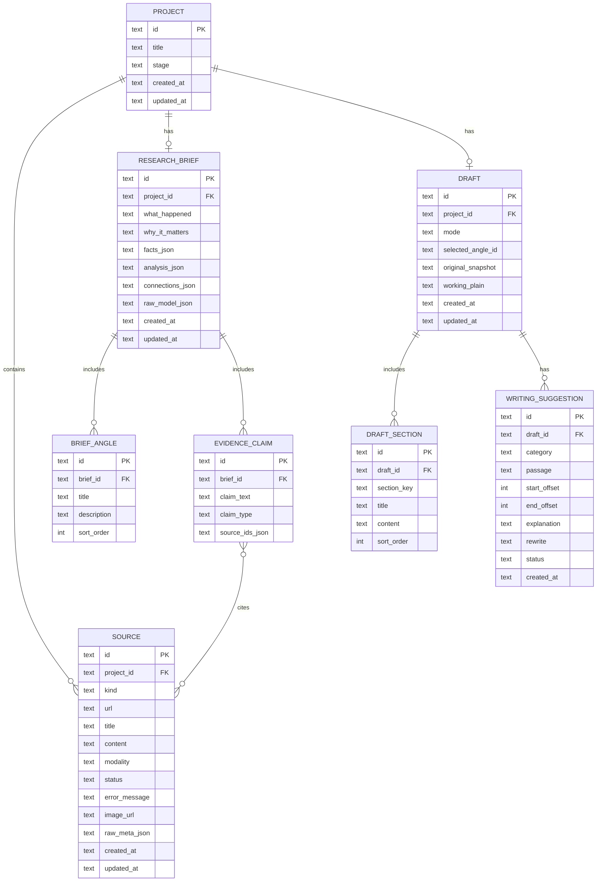

# Data Model (SCHEMA)

**Status:** Phase 3 — ready for review  
**Persistence:** SQLite (local file, e.g. `data/editorial.db`)  
**Last updated:** 2026-11-03

## 1. Design principles

- One active **Project** is enough for MVP (table still allows multiple rows for future).  
- Prefer structured columns + JSON text for nested LLM payloads where querying is unnecessary.  
- Every factual claim references `source_id`s that exist in the project.  
- Draft keeps `original_snapshot` separate from working section content.

## 2. ER diagram



## 3. Enumerations

| Enum | Values |
|---|---|
| `project.stage` | `sources` \| `research` \| `compose` (legacy `draft`/`writing` coerce to `compose`) |
| `source.kind` | `article` \| `tweet` \| `other` |
| `source.modality` | `url` \| `paste` \| `url_and_paste` \| `x_api` |
| `source.status` | `pending` \| `ready` \| `needs_content` \| `failed` |
| `evidence.claim_type` | `fact` \| `analysis` \| `speculation` |
| `draft.mode` | `starter_draft` \| `blank` (legacy `outline_only`/`manual` → `blank`) |
| `draft_section.section_key` | freeform slug/uuid (starter template may use classic keys) |
| `suggestion.category` | `complex` \| `jargon` \| `passive` \| `adverb` \| `filler` \| `weasel` (ADR-018) |
| `suggestion.status` | `pending` \| `accepted` \| `rejected` |

## 4. Entity details

### PROJECT
| Column | Type | Notes |
|---|---|---|
| id | TEXT PK | ULID/UUID |
| title | TEXT | default "Untitled editorial" |
| stage | TEXT | current UI stage |
| created_at / updated_at | TEXT ISO-8601 | |

### SOURCE
| Column | Type | Notes |
|---|---|---|
| content | TEXT | extracted or pasted body; empty if needs_content |
| url | TEXT NULL | unique per project when not null (index) |
| image_url | TEXT NULL | display image: upload path (`/api/uploads/...`) or absolute og:image URL; upload wins when set |
| raw_meta_json | TEXT | optional extractor metadata (may include `ogImageUrl`) |
| **Usable content rule** | | `status = ready` AND `length(trim(content)) > 0` |
| **Uploads dir** | | `{dirname(DATABASE_PATH)}/uploads/{projectId}/{sourceId}.{ext}` (ADR-017) |

### RESEARCH_BRIEF
| Column | Type | Notes |
|---|---|---|
| what_happened | TEXT | |
| why_it_matters | TEXT | founders/builders/operators |
| facts_json | TEXT | array of strings or rich objects |
| analysis_json | TEXT | analysis/speculation content |
| connections_json | TEXT | cross-source story seeds |
| raw_model_json | TEXT | last validated model payload |

Light edits update these columns directly. Full regenerate replaces child angles/claims.

### BRIEF_ANGLE / EVIDENCE_CLAIM
- Angles: selectable for draft generation (`selected_angle_id` on DRAFT may reference BRIEF_ANGLE.id or store denormalized title if user edits angle text — prefer angle id + allow title override field on draft).  
- Claims: `source_ids_json` is a JSON array of SOURCE.id; validated on write.

### DRAFT / DRAFT_SECTION
- `purpose` TEXT on sections (why this section exists; required when user adds a section).  
- `working_plain` = concatenation for detectors/metrics: headline as `# {content}`, other sections as `## {title}` + body (ADR-019).  
- MD preview / Copy MD / `.md` / PDF use `articlePlain` (headline H1 + bodies only; no scaffolding `## Title` wrappers).  
- Section order: `sort_order`; reorder via `POST /api/draft/sections/reorder` `{ orderedKeys }`.  
- `original_snapshot` = plain text baseline for compare (set once on first starter).  
- `awaitingStart` (derived): no section rows after Change angle — UI shows Blank/Starter picker.  
- `sources` section (when present) stores citation list; regen refreshes from project sources only.

### WRITING_SUGGESTION
- Offsets are relative to `working_plain` at analysis time.  
- On any working-text edit that invalidates offsets, clear pending suggestions and require re-analyze (simple MVP rule).  
- Accept applies rewrite at span and marks accepted; recompute `working_plain` + sections mapping.

## 5. Indexes

- `source(project_id)`  
- `UNIQUE(project_id, url) WHERE url IS NOT NULL` (SQLite partial unique index)  
- `draft_section(draft_id, section_key)` UNIQUE  
- `writing_suggestion(draft_id, status)`  

## 6. JSON structures (illustrative)

### facts_json item
```json
{ "text": "...", "sourceIds": ["src_1"] }
```

### connections_json item
```json
{ "text": "...", "sourceIds": ["src_1", "src_2"] }
```

### Gemini brief response (Zod-validated)
```json
{
  "whatHappened": "...",
  "whyItMatters": "...",
  "facts": [{ "text": "...", "sourceIds": ["..."] }],
  "analysis": [{ "text": "...", "kind": "analysis|speculation", "sourceIds": ["..."] }],
  "connections": [{ "text": "...", "sourceIds": ["..."] }],
  "angles": [{ "title": "...", "description": "..." }]
}
```

### Draft generation response
```json
{
  "sections": [
    { "key": "headline", "title": "Headline", "content": "..." },
    { "key": "what_happened", "title": "What happened", "content": "..." }
  ]
}
```

## 7. Data lifecycle

1. Create default project on first load if none exists.  
2. Sources accumulate; deleting a source used by claims shows warning (MVP: allow delete; claims may show broken refs — prefer soft block if cited).  
3. Brief regenerate deletes/replaces angles + claims.  
4. Draft generate replaces sections; preserves `original_snapshot` if already set.  
5. Analyze replaces all `pending` suggestions.  
6. No multi-device sync.

## 8. Persistence requirements

- DB file path via `DATABASE_PATH` (default `./data/editorial.db`).  
- Migrations: simple numbered SQL or Drizzle migrate — choose in implementation milestone M1.  
- Backup: not required for MVP.
